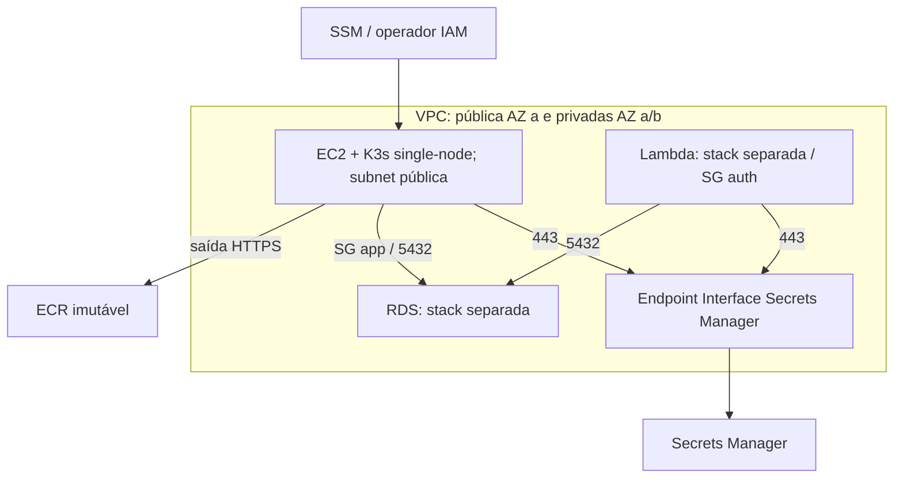

# Oficina — infraestrutura AWS/K3s, Fase 3

**Grupo 97** · **Pedro Paulo dos Santos Silva** · Discord **pedropaulo6447**.
Stack Terraform de rede, EC2/K3s, IAM do nó, ECR e endpoint privado Secrets Manager.
[Entrega consolidada](https://github.com/ppdssdev/tech-challenge-oficina/blob/main/docs/fase3/README.md) · [evidências deste repo](docs/fase3-evidence.md).

## Estado auditado e stack

2026-11-03: EC2 **m7i-flex.large** running, K3s **v1.34.6+k3s1**, um nó Ready,
SSM Online, API 3/3 e HPA operacional. ECR IMMUTABLE/KMS/scanOnPush; endpoint Secrets
Manager Interface disponível em duas subnets. SG app sem ingressos; API ClusterIP,
sem Ingress. Prometheus/Grafana/tracing não constam no inventário do cluster;
Metrics Server está operacional. Produção não demonstrada.

Terraform 1.14.6/provider AWS 6.38.0, Ubuntu 24.04 amd64, scripts Bash e políticas
Python. [compute.tf](compute.tf) usa AMI informada/verificada e K3s fixado no bootstrap.
Default de instance_type é t3.medium; o tipo observado é alternativa permitida.
Sem plan/state, a auditoria não certifica ausência de drift.



[Arquitetura específica](docs/aws-architecture.md),
[contrato v3](docs/stack-contract.md), [endpoint privado](docs/secretsmanager-endpoint.md),
[ADR K3s/EKS](docs/adr/0001-k3s-single-node.md) e
[ADR Terraform por repo](docs/adr/0002-terraform-repos.md).

## Responsabilidade e segurança

[network.tf](network.tf): VPC, uma subnet pública/IGW e duas privadas isoladas;
sem NAT Gateway. [security.tf](security.tf): SG app/auth; sem 22/6443 públicos,
HTTPS ingress opt-in, saída HTTPS do nó e 5432 privado. IMDSv2 required/hop 1,
EBS criptografado e bootstrap com controles. IAM do nó permite SSM, pull ECR e
leituras específicas de segredos. Não há sincronização automática de Secrets
Kubernetes comprovada; os runbooks da API tratam configuração externa.

RDS pertence ao repo infra-rds; Lambda/Gateway ao auth. Não são criados nesta stack.
O endpoint Secrets Manager é opcional, default desligado, mas foi observado ativo;
private DNS e policy devem contemplar auth/app. Não colocar credenciais em tfvars,
outputs ou logs. [Relatório de segurança](docs/security-report.md).

## Validação local e CI

Requisitos e versões completas em [workflow](.github/workflows/ci.yml) e
[preflight](scripts/preflight.sh): Terraform, Python 3.12 com Checkov 3.2.471 e
bc-python-hcl2 0.4.3, ShellCheck; TFLint 0.61.0 na CI.

```bash
python3 -m venv .venv
. .venv/bin/activate
pip install checkov==3.2.471 bc-python-hcl2==0.4.3
bash scripts/preflight.sh
terraform fmt -check -recursive
git diff --check
```

O preflight valida configuração/políticas/testes e não provisiona AWS; init usa
backend=false. CI tem preflight e TFLint, sem deploy/credenciais AWS em main.
[Run da baseline aprovado](https://github.com/ppdssdev/tech-challenge-oficina-infra-k3s/actions/runs/41625905236).
Resultados antigos de Checkov/provider nos prompts são históricos, não estado do CI atual.

## Deploy, operação e recuperação

[Runbook de deployment](docs/deployment-runbook.md) descreve preparação de conta,
AMI, orçamento, variáveis e revisão de plan antes de provisionar. Não aplicar
exemplos de tfvars sem preencher/revisar valores. [Contrato](docs/stack-contract.md)
publica integration_contract v3 para RDS/auth; não transportar secret values.
[backend.tf](backend.tf) define S3 staging/k3s com lockfile e encrypt; procedimento
[MIGRACAO-BACKEND.md](MIGRACAO-BACKEND.md). A auditoria documental não leu/migrou state.

Operação: [checklist operacional](docs/operational-validation.md),
[backup/restore](docs/backup-restore.md), [desmontagem](docs/destroy-runbook.md).
Listagens atuais comprovam nó/API/SSM, mas reboot, restore e bloqueio IMDS nos pods
continuam pendentes. Não executar ensaios destrutivos para validar documentação.

[PR OIDC #5](https://github.com/ppdssdev/tech-challenge-oficina-infra-k3s/pull/5)
propõe federação de validação; não está integrada nem entrega CD. A SCP negou leitura
do provider na auditoria. Não contornar a política. Release da API por digest é
responsabilidade do [repo Java](https://github.com/ppdssdev/tech-challenge-oficina).

## Custos e limitações

Single-node não tem HA; HPA multiplica pods no mesmo nó. Custos: EC2 do tipo real,
EBS/snapshots, IPv4, ECR, endpoint Interface em duas AZs, tráfego e operação K3s;
RDS/auth têm custos próprios. [Estimativas históricas](docs/cost-estimate.md) e
[Free Plan](docs/free-plan-compatibility.md) exigem atualização com Billing/preço
antes de decisão. Não foi auditada fatura nem prometida gratuidade.

Não há Swagger neste repositório de infraestrutura. Interfaces são outputs Terraform
v3; API/OpenAPI pertencem ao Java. [RDS](https://github.com/ppdssdev/tech-challenge-oficina-infra-rds)
e [Auth](https://github.com/ppdssdev/tech-challenge-oficina-auth-lambda) consomem o contrato.
