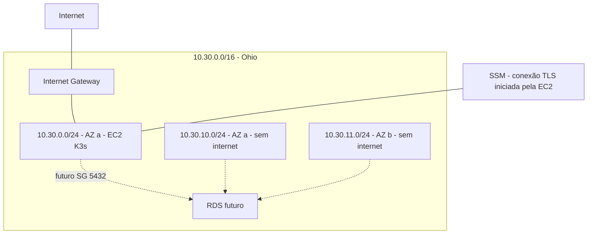
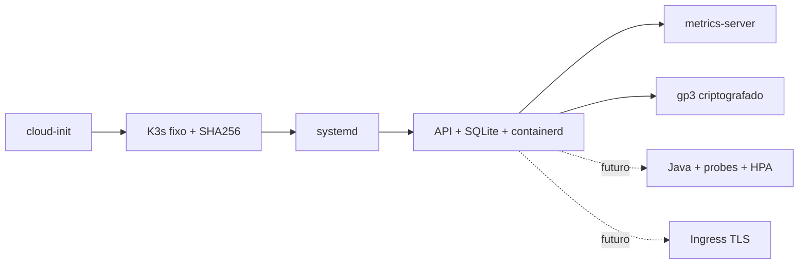

# Oficina — infraestrutura AWS/K3s (Fase 3)

Terraform real para **staging em us-east-2**, pronto para revisão e provisionamento
posterior. **Nenhum recurso AWS provisionado; K3s não validado em execução na AWS.**
Sem CD, plan real no CI, apply/destroy automático, OIDC de criação ou merge automático.





Rede em network.tf; SGs em security.tf; IAM mínimo SSM em iam.tf; EC2/AMI/IMDSv2
em compute.tf; interfaces em outputs.tf. Uma EC2, root gp3 30 GiB (máximo 40),
sem SSH, 6443 público, NodePort público, NAT, EKS, ALB/NLB, EIP ou banco.
HTTPS ingress desabilitado por padrão; saída TLS para bootstrap/SSM/registries.
EBS persiste em reboot/stop; será apagado em replace/destroy. Single-node sem HA.

Pré-requisitos: Terraform **1.14.6**, provider **6.38.0** com lockfile, Python 3.12,
Checkov **3.2.471**, bc-python-hcl2 **0.4.3**, ShellCheck e TFLint **0.61.0**.
Conta AWS não é necessária à validação:

```sh
python3 -m venv .venv
. .venv/bin/activate
pip install checkov==3.2.471 bc-python-hcl2==0.4.3
bash scripts/preflight.sh
tflint --init
tflint
```

Obrigatórias antes de provisionar: `aws_account_id`, `owner`, `ami_id` oficial
Canonical Ubuntu 24.04 amd64 fixo. Copiar staging.tfvars.example para arquivo local
ignorado. Confirmar elegibilidade/custos antes de marcar eligibility_confirmed.
Default t3.medium **não tem elegibilidade presumida**; alternativa c7i-flex.large
exige avaliação. Production fica reservada para outra revisão, sem segundo ambiente.

Comandos previstos, **apenas depois de autorização explícita**:

```sh
terraform plan -var-file=environments/staging.tfvars -out=staging.tfplan
terraform apply staging.tfplan
terraform plan -destroy -var-file=environments/staging.tfvars -out=cleanup.tfplan
terraform apply cleanup.tfplan
```

Leia o [passo a passo de provisionamento](docs/deployment-runbook.md), incluindo
AMI, credenciais temporárias, backend S3 futuro, SSM, túnel Kubernetes e rollback;
e o [procedimento de destruição](docs/destroy-runbook.md), incluindo dependências,
backups e busca de órfãos. Estes comandos não foram executados nesta entrega.

Ordem: K3s/rede -> RDS -> migrações/aplicação -> Lambda/auth -> observabilidade.
[Arquitetura e contrato v2](docs/aws-architecture.md) define outputs tipados,
regras SG de propriedade da stack RDS e publicação sem leitura de state cruzado.
Registry, banco, endpoint público/JWKS/TLS e aplicação permanecem futuros.

[Custos](docs/cost-estimate.md), [Free Plan](docs/free-plan-compatibility.md) e
[relatório de segurança](docs/security-report.md) são leitura obrigatória.
Budget US$5 é alerta, não teto de gasto; e-mails não confirmados. Billing deve ser
acompanhado pelo proprietário. Nenhum upgrade ou acesso root necessário.

CI executa fmt/init sem backend/validate, TFLint, Checkov, políticas de inventário,
segurança/custo, testes por mutação, testes simulados de bootstrap, ShellCheck e
scanner de segredos. A antiga barreira de bootstrap foi substituída por baseline
AST revisável: novos recursos exigem revisão de custos e segurança. Exceções são
locais e justificadas, sem soft-fail. CI não comprova conectividade ou disponibilidade.
