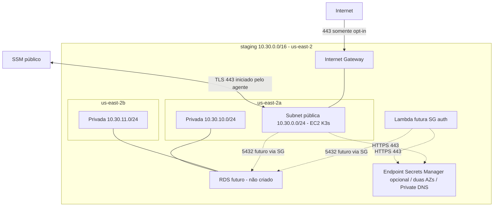
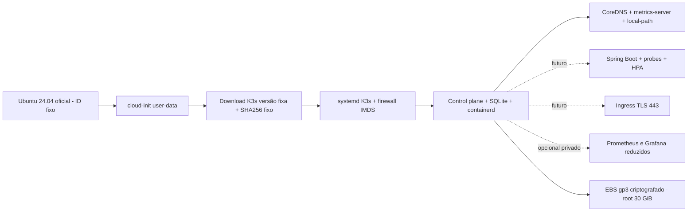

# Arquitetura AWS e contrato v3

Código implementado; nenhum provisionamento ou teste de conectividade AWS realizado.
Staging usa 10.30.0.0/16; reservar 10.31.0.0/16 para futura production, em outro
root/state, após PR de autorização. Pods 10.42.0.0/16 e serviços 10.43.0.0/16 não
sobrepõem esses CIDRs. Confirmar ausência de sobreposição com VPN/rede corporativa.

Apenas a tabela pública tem 0.0.0.0/0 para IGW. Privadas têm somente rota local,
com associações explícitas. DNS AmazonProvidedDNS resolve nomes públicos/privados;
regras SG não bloqueiam o resolver Amazon. Não há IPv6, NAT, peering,
EKS, balanceador, EIP, RDS ou serviços de logs pagos nesta stack.
O endpoint Secrets Manager opcional usa as subnets privadas e SG exclusivo,
desabilitado por padrão; [ownership, impacto DNS e custos](secretsmanager-endpoint.md).

K3s v1.34.6+k3s1 usa checksum amd64 do release oficial, registrado no script.
Não executa instalador remoto. Sem apt update no boot: usa componentes da AMI,
verifica curl/iptables/SSM e falha explicitamente se faltarem. SSM usa o snap
pré-instalado na imagem Ubuntu; essa premissa deverá ser validada no primeiro boot.
A AMI não usa latest: `ami_id` é obrigatório, e data source exige proprietário
Canonical 099720109477, Ubuntu Noble amd64/hvm. Registrar ID, nome e data da AMI
na evidência do plan. Atualizações de AMI/K3s devem passar por revisão, scanner e
recriação com backup; não há atualização automática silenciosa de K3s.

Systemd habilita reinício após reboot; configuração e datastore persistem no root.
K3s gera token, chave de criptografia e kubeconfig **na máquina**, nunca no state
ou user-data. O kubeconfig é root:0600. Logs em journal e
/var/log/oficina-bootstrap.log (0600); não exportar logs de forma indiscriminada.
Sem HA, tolerância a perda de AZ ou backup automatizado. `local-path` não é storage
replicado. Root persiste em stop/start, mas é apagado em replace/destroy.

## Contrato entre stacks

O [contrato v3](stack-contract.md) é a referência normativa de tipos, ownership,
publicação e validação do consumidor. K3s gerencia os egress app/auth TCP 5432
para CIDRs privados; RDS gerencia seu SG e os ingress por SG app/auth.
Não há dependência K3s → RDS ou leitura de state cruzado.

## Integrações posteriores

Imagens: ECR privado, imutável, criptografado e com scan no push está declarado
em ecr.tf. IAM de pull do nó é restrito ao repositório, exceto token de autenticação.
A entrega/renovação de credenciais ao runtime será validada na integração futura.
Workloads não herdam credenciais AWS: hop limit 1 + firewall forwarding IMDS.
Proibir hostNetwork/privileged/hostPath por Pod Security Admission antes de aceitar
workloads; pods privilegiados podem contornar o isolamento do host. Para APIs AWS,
projetar federação OIDC/STS específica por service account ou broker; IRSA/EKS Pod
Identity não existe automaticamente em K3s. Não copiar access keys para manifests.

Ingress fica desabilitado (Traefik e ServiceLB off). Futuro controller deve mapear
443 do host explicitamente; NodePorts públicos permanecem bloqueados. TLS com
certificado e DNS aprovados; DNS-01 evita abrir 80. Se provedor DNS exigir AWS,
conceder role específica via federação. AWS ACM público não entrega automaticamente
certificado utilizável nesse host. Sem domínio/ingress, não existe endpoint app.

JWKS futuro: endpoint HTTPS público de API Gateway ou S3/CloudFront, independente
do banco e do estado K3s; só chaves públicas. A API Java alcançará JWKS por 443.
Lambda privada alcança RDS localmente, mas **não ganha internet por estar em subnet
pública**. Secrets Manager usa o endpoint privado opcional quando habilitado;
JWKS externo continua sem caminho de internet. Cotar endpoint por AZ/hora e GB
antes de criar. Alternativas para JWKS: serviço fora da Lambda/VPC, material
público cacheado, reduzir dependências de rede. Não usar EC2 como NAT improvisado.

Demonstração futura: requests/limits Java compatíveis com 4 GiB, readiness em
/actuator/health/readiness e liveness em /actuator/health/liveness conforme app;
metrics-server é incluído, HPA requer requests de CPU. Carga controlada, observar
kubectl top e HPA; single-node limita réplicas e não aumenta capacidade física.
Prometheus/Grafana só após medir memória: retenção curta, requests/limits e acesso
via SSM/port-forward. Sem stack completa automática neste bootstrap.

## Gate da integração RDS futura

Seguir [contrato v3](stack-contract.md). RDS deve validar identidade, subnets e SGs,
criar somente recursos próprios e ingresso 5432 app/auth. Após provisionamento
futuro autorizado, testar DNS privado, TCP/TLS e bloqueio de origem não autorizada,
sem registrar senhas. O root K3s não provisiona banco.
