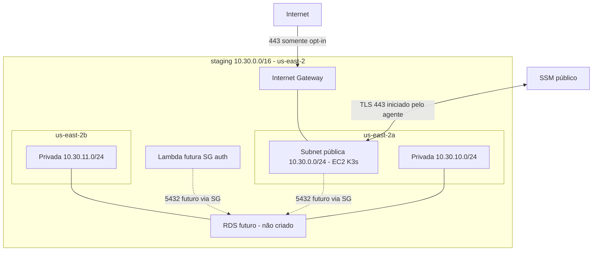
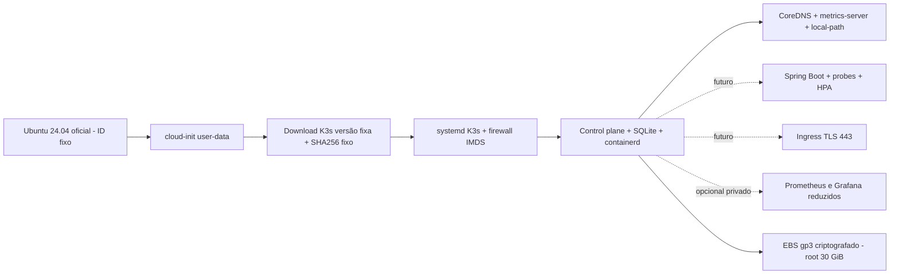

# Arquitetura AWS e contrato v2

Código implementado; nenhum provisionamento ou teste de conectividade AWS realizado.
Staging usa 10.30.0.0/16; reservar 10.31.0.0/16 para futura production, em outro
root/state, após PR de autorização. Pods 10.42.0.0/16 e serviços 10.43.0.0/16 não
sobrepõem esses CIDRs. Confirmar ausência de sobreposição com VPN/rede corporativa.

Apenas a tabela pública tem 0.0.0.0/0 para IGW. Privadas têm somente rota local,
com associações explícitas. DNS AmazonProvidedDNS resolve nomes públicos/privados;
regras SG não bloqueiam o resolver Amazon. Não há IPv6, NAT, peering, endpoints,
EKS, balanceador, EIP, registry, RDS ou serviços de logs pagos.

K3s v1.34.6+k3s1 usa checksum amd64 do release oficial, registrado no script.
Não executa instalador remoto. Sem apt update no boot: usa componentes da AMI,
verifica curl/iptables/SSM e falha explicitamente se faltarem. SSM usa o snap
pré-instalado na imagem Ubuntu; essa premissa deverá ser validada no primeiro boot.
A AMI não usa latest: `ami_id` é obrigatório, e data source exige proprietário
Canonical 099720109477, Ubuntu Noble amd64/hvm. Registrar ID, nome e data da AMI
na evidência do plan. Atualizações de AMI/K3s devem passar por revisão, scanner e
recriação com backup; não há atualização automática silenciosa de K3s.

Systemd habilita reinício após reboot; configuração e datastore persistem no root.
K3s gera token, chave de criptografia e kubeconfig **na máquina**, nunca no state
ou user-data. O kubeconfig é root:0600. Logs em journal e
/var/log/oficina-bootstrap.log (0600); não exportar logs de forma indiscriminada.
Sem HA, tolerância a perda de AZ ou backup automatizado. `local-path` não é storage
replicado. Root persiste em stop/start, mas é apagado em replace/destroy.

## Contrato entre stacks

| Output | Tipo inferido pelo Terraform | Consumidor |
|---|---|---|
| vpc_id | string | RDS, auth |
| public_subnet_id | string | operação |
| private_subnet_ids | list(string), ordem AZ a/b | subnet group RDS e Lambda |
| app_security_group_id | string | origem da regra RDS |
| auth_security_group_id | string | ENIs Lambda e origem da regra RDS |
| instance_id | string | SSM |
| instance_public_ip | string, mutável após stop/start | futuro DNS |
| integration_contract | object, schema_version=2 | validação do consumidor |

Terraform outputs não aceitam argumento `type`; os tipos são inferidos das
expressões. `implemented=true` significa implementação no código, não implantação.
Registry `image_repository_url` continua em planned_fields; não há output fictício.
Nenhuma senha, token, kubeconfig ou segredo é exportado. Schema v1 era intenção;
consumidores devem validar explicitamente v2, ambiente e região.

Depois do apply autorizado, publicar somente estes outputs por transferência
controlada de JSON ou futuramente SSM `/oficina/staging/k3s/v2/...` (não criado aqui).
Não usar terraform_remote_state: exporia todo o state. Registrar commit produtor.
RDS deve receber variáveis string/list(string), validar dois IDs de subnets em AZs
diferentes nesta VPC, criar seu SG e entrada 5432 exclusivamente de SG app/auth.
**A stack RDS também será dona das duas regras de saída 5432 dos SG app/auth para
seu SG**, usando recursos aws_vpc_security_group_egress_rule. Esses SGs não têm
regras inline; esta stack só gerencia saída 443 app. Essa extensão evita dependência
K3s -> RDS e mantém um dono por regra. RDS precisa testes de contrato próprios.
A Lambda associa auth às ENIs privadas. Pods saem por masquerade no IP da EC2,
portanto o SG app identifica tráfego ao banco; não existe SG por pod neste K3s.

## Integrações posteriores

Imagens: build e push pelo CI da aplicação para registry aprovado (ex.: GHCR);
pull via HTTPS. Registry privado exige imagePullSecret entregue fora do Terraform
com token curto/rotação. Nenhum ECR ou permissão ECR é criado nesta etapa.
Workloads não herdam credenciais AWS: hop limit 1 + firewall forwarding IMDS.
Proibir hostNetwork/privileged/hostPath por Pod Security Admission antes de aceitar
workloads; pods privilegiados podem contornar o isolamento do host. Para APIs AWS,
projetar federação OIDC/STS específica por service account ou broker; IRSA/EKS Pod
Identity não existe automaticamente em K3s. Não copiar access keys para manifests.

Ingress fica desabilitado (Traefik e ServiceLB off). Futuro controller deve mapear
443 do host explicitamente; NodePorts públicos permanecem bloqueados. TLS com
certificado e DNS aprovados; DNS-01 evita abrir 80. Se provedor DNS exigir AWS,
conceder role específica via federação. AWS ACM público não entrega automaticamente
certificado utilizável nesse host. Sem domínio/ingress, não existe endpoint app.

JWKS futuro: endpoint HTTPS público de API Gateway ou S3/CloudFront, independente
do banco e do estado K3s; só chaves públicas. A API Java alcançará JWKS por 443.
Lambda privada alcança RDS localmente, mas **não ganha internet por estar em subnet
pública**. Secrets Manager/JWKS externo exigiriam endpoints ou NAT; antes de criar,
cotar por AZ/hora e GB. Alternativas: JWKS servido fora da Lambda/VPC, material
público cacheado, reduzir dependências de rede. Não usar EC2 como NAT improvisado.

Demonstração futura: requests/limits Java compatíveis com 4 GiB, readiness em
/actuator/health/readiness e liveness em /actuator/health/liveness conforme app;
metrics-server é incluído, HPA requer requests de CPU. Carga controlada, observar
kubectl top e HPA; single-node limita réplicas e não aumenta capacidade física.
Prometheus/Grafana só após medir memória: retenção curta, requests/limits e acesso
via SSM/port-forward. Sem stack completa automática neste bootstrap.
