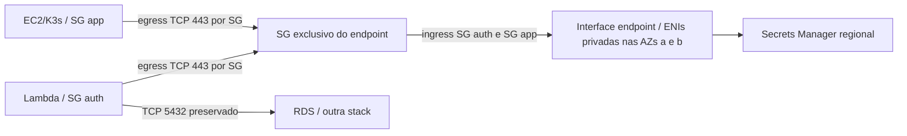

# Secrets Manager privado — Prompt 11.1

Preparação de código, sem provisionamento. `enable_secretsmanager_endpoint=false`
é o padrão: nenhum dos seis recursos novos é instanciado e o output
`secretsmanager_endpoint_id` é null (outputs null podem ser omitidos pelo Terraform).
Quando habilitado, usa as duas subnets privadas existentes, uma por AZ, com Private
DNS e serviço `com.amazonaws.us-east-2.secretsmanager`.

## Ownership e segurança

| Recurso novo, somente quando habilitado | Dono |
|---|---|
| `aws_vpc_endpoint.secretsmanager["enabled"]` | infra-k3s |
| `aws_security_group.secretsmanager_endpoint["enabled"]` | infra-k3s |
| `aws_vpc_security_group_ingress_rule.auth_to_secretsmanager["enabled"]` | infra-k3s |
| `aws_vpc_security_group_egress_rule.auth_to_secretsmanager["enabled"]` | infra-k3s |
| `aws_vpc_security_group_ingress_rule.app_to_secretsmanager["enabled"]` | infra-k3s |
| `aws_vpc_security_group_egress_rule.app_to_secretsmanager["enabled"]` | infra-k3s |

O serviço cria duas ENIs como parte do endpoint, sem recursos ENI gerenciados
separadamente. As regras usam referências de SG, protocolo TCP e somente porta
443. O SG do endpoint não inicia conexões; respostas usam o controle stateful.
Não há regras inline, associações concorrentes, CIDRs de ingresso/egress HTTPS
auth, NAT ou rota de internet privada. O egress app HTTPS público existente para
bootstrap/SSM/ECR é preservado; já cobria os IPs privados, mas a nova regra por SG
explicita o caminho app → endpoint. SGs são aditivos: ela não restringe o egress anterior.
As quatro regras app/auth PostgreSQL 5432 e os recursos RDS permanecem intactos.

A endpoint policy tem dois statements separados; não combina listas de roles e
segredos que dariam acesso cruzado. Ambos permitem somente `GetSecretValue`, com
`Principal="*"` condicionado por `ArnEquals` à role IAM exata (incluindo suas sessões).

| Consumidor | Principal | Segredos permitidos pelo endpoint |
|---|---|---|
| Lambda auth | `secretsmanager_endpoint_role_arn` | Somente `secretsmanager_endpoint_secret_arn` completo |
| EC2/K3s | `aws_iam_role.node.arn` | Os mesmos três ARNs de `aws_iam_role_policy.app_secrets` |

Os dois ARNs auth são obrigatórios ao habilitar; validações rejeitam wildcards,
outra conta, segredo fora de Ohio e ARN de sessão STS. A permissão do nó reutiliza
`jsondecode(aws_iam_role_policy.app_secrets.policy).Statement[0].Resource`: nomes
`oficina/staging/app-db-password`, `oficina/staging/jwt-secret` e
`oficina/staging/admin-password`, na conta/região autorizadas. O sufixo `-??????`
existente cobre somente os seis caracteres gerados pelo Secrets Manager; não há
wildcard no nome do segredo. Não concede acesso ao master RDS ou a outros nomes.
O IAM do nó permanece intacto, com somente `GetSecretValue` nesses três recursos.
Não se criam/leem segredos, nem se consulta state auth.
A [endpoint policy complementa o IAM](https://docs.aws.amazon.com/vpc/latest/privatelink/vpc-endpoints-access.html);
a role Lambda deve ter IAM para seu segredo exato e a condição `aws:SourceVpce`,
configurados pela stack auth. Isso continua sendo requisito de integração, sem
modificação em outro repositório. Caso use CMK, revisar a autorização KMS específica;
esta alteração não cria chave nem concede `kms:*`.

Private DNS é preservado: o hostname regional padrão passa a resolver para ENIs
privadas em toda a VPC, conforme a
[documentação do Secrets Manager](https://docs.aws.amazon.com/secretsmanager/latest/userguide/vpc-endpoint-overview.html).
A VPC já habilita resolução e hostnames DNS; suas rotas locais ligam as subnets.
A revisão estática confirma os dois caminhos TCP 443 e as permissões de leitura:
auth → endpoint e EC2/K3s → endpoint. Assim, os consumidores declarados não são
bloqueados por SG/policy ao habilitar Private DNS. Acesso EC2 com outra role ou a
outros segredos/APIs é negado pelo endpoint; revisar novos consumidores antes de
ativar. APIs SSM/ECR/JWKS não são redirecionadas por este endpoint específico.

Não é uma prova de conectividade em execução: DNS customizado, NACLs, policies dos
segredos, KMS e credenciais efetivas precisam ser verificados no provisionamento
autorizado. O bloqueio IMDS para pods permanece; não habilitar acesso de pods ao
instance profile como solução. O consumidor que já usa a role do nó deve manter
seu fluxo autorizado de obtenção/injeção de segredos.

## Integração e ativação futura

1. Revisar disponibilidade regional nas duas AZs, orçamento, DNS/NACLs, consumidores
   afetados e ausência de outro endpoint com Private DNS para o mesmo serviço/VPC.
2. Definir os ARNs não secretos em `.tfvars` local ignorado. Usar o segredo de
   aplicação da Lambda, nunca o master RDS. O ARN da role deve corresponder à role
   declarada pela stack auth (`oficina-staging-auth-execution` no código atual);
   a condição por ARN permite preparar o endpoint antes da criação dessa role.
3. Habilitar `enable_secretsmanager_endpoint=true` **antes de ativar a Lambda que
   utiliza Secrets Manager**, após revisão e autorização específica de implantação.
4. Após provisionamento futuro autorizado, fornecer `secretsmanager_endpoint_id`
   como `secrets_endpoint_id` da stack auth. Preservar separadamente o objeto
   `integration_contract` v3 sem novos campos. Não copiar state nem segredos.
5. Confirmar o ARN da role/segredo auth e a role do nó com seus três segredos.
   Nas duas AZs, validar DNS privado e TLS. Testar auth lendo seu segredo e EC2/K3s
   lendo cada um dos três segredos, sem registrar valores. Testar negações para
   outra role, outro segredo e ações de escrita; testar acesso cruzado quando os
   segredos auth/app forem distintos. Manter HTTP fechado e concorrência zero
   até cumprir os gates da stack auth. O endpoint não ativa a função nem abre JWKS.

Antes de desabilitar/remover o endpoint, interromper os consumidores e revisar as
dependências. Alterar a variável para false numa implantação futura remove os
seis recursos e as ENIs; não remove regras PostgreSQL, Lambda ou RDS.
Desabilitar concorrência Lambda não interrompe a cobrança de um endpoint existente.

## Uma versus duas AZs e custo recorrente

| Opção | Disponibilidade do caminho até Secrets Manager | Base mensal, 730 horas |
|---|---|---|
| Desabilitado (padrão) | Lambda privada sem esse caminho HTTPS | Zero para estes recursos novos |
| Uma AZ (alternativa, não implementada) | Uma ENI; falha dessa AZ interrompe esse caminho inclusive para Lambda na outra AZ | 730 AZ-horas × tarifa regional |
| Duas AZs (implementado quando habilitado) | Uma ENI por AZ; elimina a dependência de uma única AZ do endpoint | 1460 AZ-horas × tarifa regional |

A decisão por duas AZs acompanha as duas subnets da Lambda. Clientes, DNS e retries
também precisam ser validados: não é garantia de failover sem interrupção nem de
HA do RDS/EC2. Para reduzir a uma AZ seria necessária uma revisão explícita do
código e da baseline, aceitando a perda de disponibilidade; não há seleção oculta.
[ENIs por subnet/AZ](https://docs.aws.amazon.com/vpc/latest/privatelink/create-interface-endpoint.html)
e [resiliência com múltiplas AZs](https://docs.aws.amazon.com/whitepapers/latest/aws-privatelink/how-does-aws-privatelink-work.html).

Referência de cálculo: com tarifa **ilustrativa de US$0,01/AZ-hora**, seriam
**US$7,30/mês em uma AZ** ou **US$14,60/mês em duas**; janela de 8 horas:
US$0,08 ou US$0,16. A página oficial apresenta essa tarifa em um exemplo de outra
região; confirmar a tarifa específica de **us-east-2 antes de implantar**.
O processamento no primeiro PB regional é US$0,01/GB. Horas parciais são cobradas
como inteiras, mesmo sem requests; total depende do tempo provisionado e dos GB.
[Preços PrivateLink consultados em 2026-11-02](https://aws.amazon.com/privatelink/pricing/).

Somam-se armazenamento/chamadas do Secrets Manager e demais serviços; tráfego
entre AZs deve ser revisto conforme o percurso e as tarifas aplicáveis, sem
presumir franquia. SGs e regras não adicionam outra tarifa horária de endpoint.
Esses valores não incluem impostos/créditos e não são cotação regional confirmada.
O total EC2/EBS/IPv4 de [custos existentes](cost-estimate.md) não inclui esse opcional.

## Validação local e pendências

Executar `terraform fmt -check -recursive`, `terraform validate`,
`python scripts/policy.py`, `python -m unittest discover -s scripts -p 'test_*.py'`,
Checkov e `git diff --check`. Testes de mutação cobrem DNS, subnets, SGs, portas,
toggle padrão, ARNs, IAM do endpoint, isolamento das stacks e ownership duplicado.
As baselines anteriores são preservadas; somente seis recursos, três variáveis
e um output foram acrescentados. Não há nova exceção Checkov nem soft-fail.
Validação estática não prova execução Terraform, resolução DNS ou acesso real.
Resultados desta aplicação e impedimentos: [Prompt 11.1](prompt11.1-result.md).
A [falha preexistente CKV_AWS_136 do ECR](checkov-ecr-CKV_AWS_136.md) permanece aberta.
